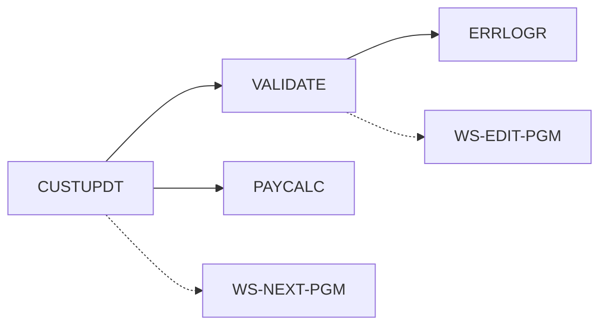

# Sample output

Generated from the synthetic fixtures in [`fixtures/`](../fixtures), so every
name and number below is reproducible:

```bash
python -m cobolkit inventory fixtures/cobol
python -m cobolkit jcl       fixtures/jcl
python -m cobolkit copybook  fixtures/copybooks/CUSTREC.cpy
```

Note what the reports refuse to pretend: the dynamic calls are drawn as dashed
edges and then named again as an explicit limit, because a call graph that
quietly omits them is worse than one that admits the gap.

---

# Program inventory

3 compilation unit(s) analyzed.

| Program | Lines | Paragraphs | Calls | Copybooks | DB2 | CICS |
| --- | --- | --- | --- | --- | --- | --- |
| `CUSTUPDT` | 85 | 8 | 3 | 2 | 1 | 0 |
| `PAYCALC` | 43 | 4 | 0 | 0 | 0 | 0 |
| `VALIDATE` | 50 | 4 | 2 | 0 | 0 | 2 |

## Call graph



Solid edges are static calls. Dashed edges are dynamic.

## Dynamic calls

These targets come from a variable, so the real callee is only known at run time. Resolve them from production load-module traces or a CALL trace before trusting any impact analysis.

- `CUSTUPDT` calls via `WS-NEXT-PGM`
- `VALIDATE` calls via `WS-EDIT-PGM`

## Called but not present

Referenced by a static CALL with no source in this set. Either the source is missing from the extract, or it is a vendor or system module.

- `ERRLOGR`

## Entry points

Nothing in this set calls these, so they are started from JCL, CICS or a scheduler -- or they are dead.

- `CUSTUPDT`

## Per-program detail

### `CUSTUPDT`

Source: `fixtures/cobol/CUSTUPDT.cbl` (85 code lines)

- Static calls: `VALIDATE`, `PAYCALC`
- Dynamic call variables: `WS-NEXT-PGM`
- Copybooks: `CUSTREC`, `SQLCA`
- DB2 tables: `CUSTOMER_ACCT`
- Files:
  - `CUSTOMER-FILE` assigned to `CUSTIN`
  - `REPORT-FILE` assigned to `RPTOUT`
- Paragraphs never PERFORMed: `UNUSED-DIAGNOSTIC` (may still be reached by fallthrough)
- Modernization risks:
  - 1 dynamic CALL target(s): the call graph cannot be completed without run-time data

### `PAYCALC`

Source: `fixtures/cobol/PAYCALC.cbl` (43 code lines)


### `VALIDATE`

Source: `fixtures/cobol/VALIDATE.cbl` (50 code lines)

- Static calls: `ERRLOGR`
- Dynamic call variables: `WS-EDIT-PGM`
- CICS commands: `LINK`, `WRITEQ`
- `GO TO` statements: 3
- Paragraphs never PERFORMed: `EDIT-FAILED`, `EDIT-DONE` (may still be reached by fallthrough)
- Modernization risks:
  - 1 dynamic CALL target(s): the call graph cannot be completed without run-time data


---

# JCL and batch data flow

## CUSTNITE

Source: `fixtures/jcl/CUSTNITE.jcl` -- 3 step(s)

| Step | Program | Procedure | Inputs | Outputs |
| --- | --- | --- | --- | --- |
| `STEP010` | `CUSTUPDT` | - | `PROD.BATCH.LOADLIB`, `PROD.CUST.MASTER(0)` | `PROD.CUST.RPT(+1)`, `&&TEMPCUST` |
| `STEP020` (conditional) | `CUSTSORT` | - | `&&TEMPCUST` | `PROD.CUST.SORTED(+1)` |
| `STEP030` | `CUSTRPT` | - | `PROD.CUST.SORTED(+1)` | - |

### Intra-job lineage


> Generation data groups in use (`PROD.CUST.MASTER(0)`, `PROD.CUST.RPT(+1)`, `PROD.CUST.SORTED(+1)`). Relative generation numbers resolve at run time, so the dataset a step actually reads depends on what ran before it.

